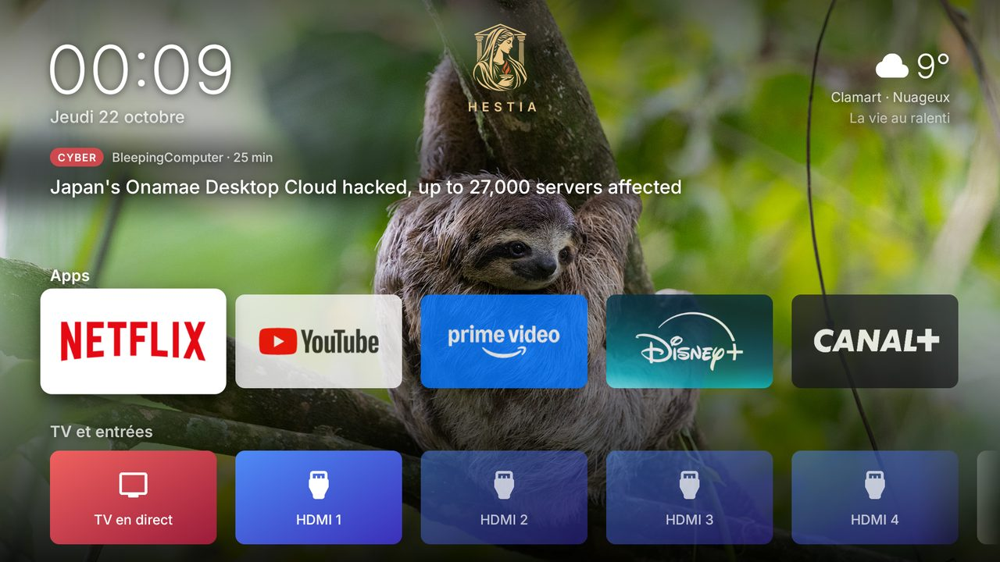
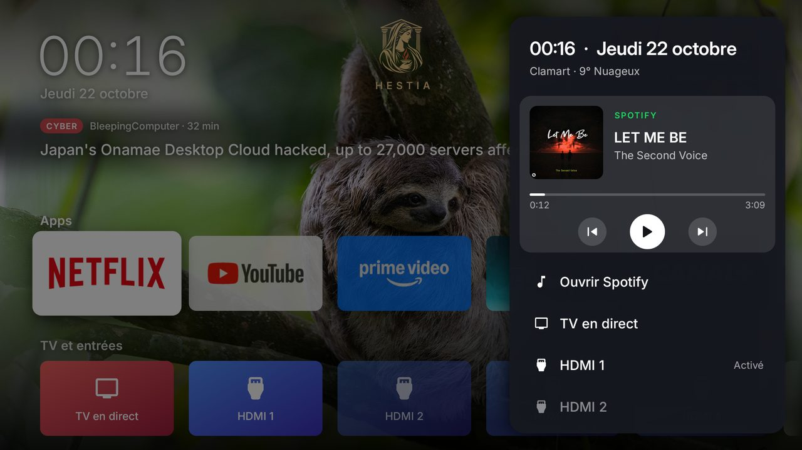
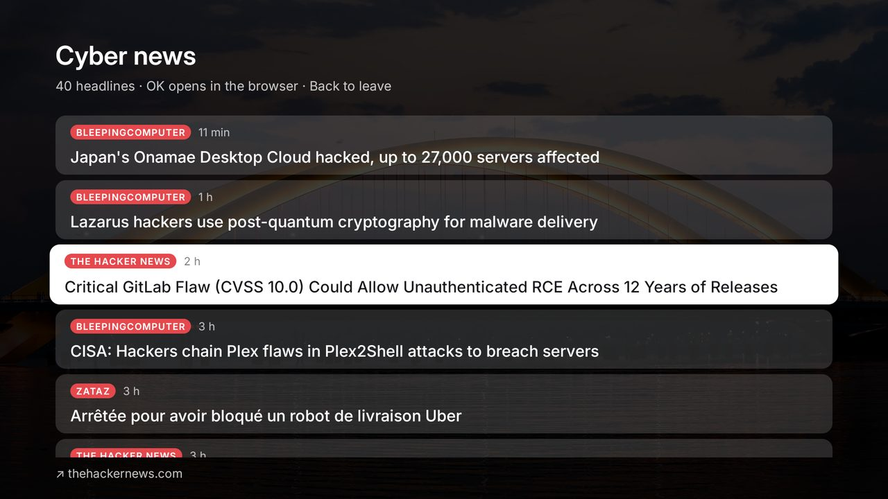
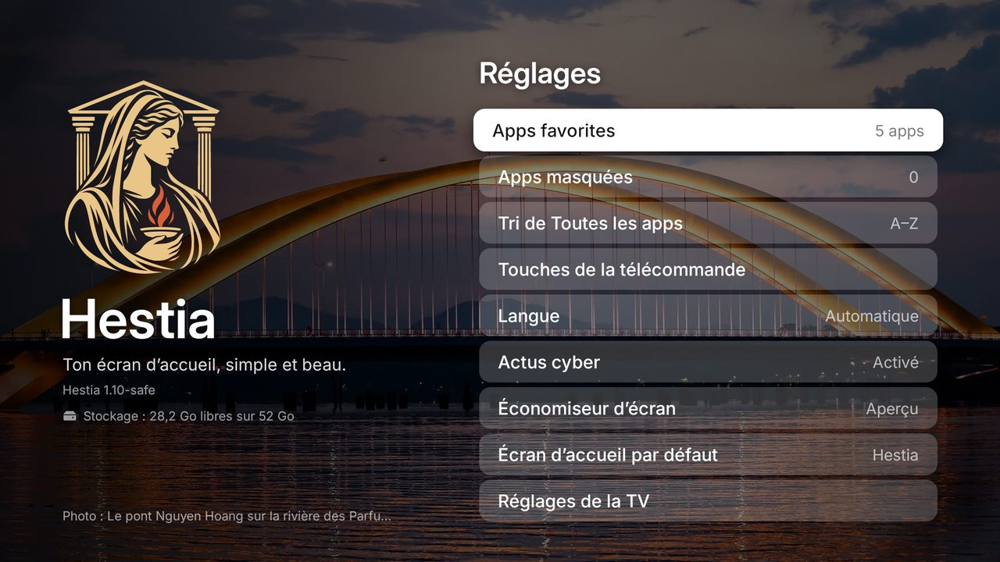
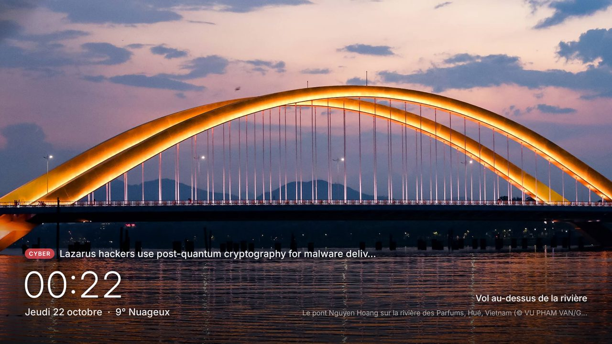

<div align="center">


# Hestia

**Un écran d’accueil Android TV simple, beau et sans compte.**
Photo du jour, météo, actus cyber, vos apps — et rien d’autre.

[](https://github.com/me02329/hestia/actions/workflows/android.yml)
[](LICENSE)




</div>

---

## ✨ Pourquoi Hestia ?

Hestia, déesse grecque du **foyer**, remplace l’accueil Google TV par un écran calme et rapide :

- 🏛️ **Rien à configurer** : pas de compte, pas de clé, pas de publicité, pas de recommandations imposées.
- ⚡ **Léger** : dessiné à la main sur `Canvas` (aucune bibliothèque), ~35 Mo de RAM, démarrage en ~1 s.
- 🔒 **Prudent** : liste fixe de serveurs HTTPS, aucune redirection, réponses bornées, aucun shell ni ADB dans l’app.
- 🎮 **Pensé pour la télécommande** : D-pad, OK, Retour, appuis longs et touches de la TV.

## 🖼️ Aperçu

<table>
  <tr>
    <td><br><sub><b>Panneau rapide</b> — lecteur en cours, sources, réglages</sub></td>
    <td><br><sub><b>Actus cyber</b> — les dernières 24 h, ouvrables dans le navigateur</sub></td>
  </tr>
  <tr>
    <td><br><sub><b>Réglages</b> — favoris, tri, touches, langue…</sub></td>
    <td><br><sub><b>Économiseur</b> — diaporama, heure, météo, une actu</sub></td>
  </tr>
</table>

<sub>Les photos visibles sur les captures sont les photos du jour de Bing (© leurs auteurs) ; elles ne sont pas incluses dans le dépôt.</sub>

## 🧭 Fonctionnalités

| | |
|---|---|
| 🌄 **Fond vivant** | Photo du jour (archive Bing), fondu toutes les 2 minutes |
| 🕰️ **En-tête** | Heure 24 h, date, emblème Hestia, météo de votre ville (Open-Meteo) |
| 🛡️ **Actus cyber** | The Hacker News, BleepingComputer, SecurityWeek, CERT-FR, ZATAZ — un titre toutes les 12 s ; ↑ puis OK pour la liste |
| ⭐ **Apps favorites** | Première rangée, choisie et ordonnée dans les réglages |
| 📺 **TV & entrées** | TV en direct, HDMI (atténués s’ils sont débranchés), recherche vocale, Play Store, réglages — cartes colorées |
| 🗂️ **Toutes les apps** | Tri A–Z, les plus utilisées ou récentes ; apps masquables |
| 🎛️ **Panneau rapide** | Lecteur (pochette, progression, ⏮ ⏯ ⏭), sources, image, son, réseau, accessoires |
| 📋 **Menu d’app** | Appui long OK : favoris, déplacer, masquer, infos, Play Store, désinstaller |
| 🌙 **Économiseur** | Diaporama 45 s par photo, zoom lent, heure, météo et une actu |
| 🌍 **Langues** | Français, English, Português — automatique selon la TV |

### 🎮 Télécommande

| Touche | Par défaut | Configurable |
|---|---|---|
| **Réglages ⚙️** | Panneau rapide — sur l’accueil *et dans les apps* | ✅ |
| **TV** | TV en direct (depuis l’accueil) | ✅ |
| **Home (appui long)** | Panneau rapide, partout | ✅ |
| **OK (appui long)** | Menu de l’app sélectionnée | — |

Chaque touche peut ouvrir le panneau rapide, la TV en direct, une entrée HDMI précise, la recherche, les réglages, Hestia
ou n’importe quelle app. Les touches dédiées (Netflix, YouTube, volume, micro) restent gérées par la TV.

## 🚀 Démarrage rapide

Prérequis : Python 3.10+, JDK **17**, SDK Android (**platform 34**, **build-tools 34.0.0**), `zip`, `adb`.

```sh
git clone https://github.com/me02329/hestia.git && cd hestia
python3 -m unittest discover -s tests -v   # tests simulés + contrôles réseau sur JVM
./build.sh                                  # crée config.properties puis Hestia.apk (+ .sha256)
```

Renseignez votre ville dans `config.properties`, relancez `./build.sh`, puis suivez
**[SAFE-DEPLOYMENT.md](SAFE-DEPLOYMENT.md)** : sauvegarde de la TV, installation, bascule de l’accueil et retour arrière,
le tout via `tools/tv_safe.py` (identité de la TV vérifiée, chaque écriture relue, journal de reprise).

```properties
# config.properties — aucune clé nécessaire
latitude=48.8566
longitude=2.3522
city=Paris
language=auto      # auto, fr, en ou pt
temperature=C      # C, F ou auto
```

> [!NOTE]
> Sur certaines TV Google TV (dont la TCL G08), le launcher d’origine passe avant tout accueil choisi.
> `tv_safe.py disable-stock-home` désactive alors **uniquement** le launcher Google et l’écran de récupération du
> setup, en l’enregistrant ; `enable-stock-home` remet tout comme avant.

## 🔐 Vie privée & sécurité

- **Réseau** : `api.open-meteo.com`, `www.bing.com` et les flux RSS listés dans `Net.java` — HTTPS uniquement,
  sans redirection, tailles et délais bornés, erreurs sans URL ni secret.
- **Liens d’actus** : seuls des liens `https` simples sont ouverts, et uniquement à votre demande (testé sur JVM).
- **Permissions** : Internet, état du réseau, et demande de désinstallation (Android affiche sa confirmation).
- **Accès facultatifs**, activés une fois par ADB et réversibles :
  - *notifications* → uniquement pour le lecteur du panneau rapide ; aucune notification n’est lue ;
  - *accessibilité* → uniquement pour la touche Réglages dans les autres apps ; aucun contenu d’écran n’est lu.
- **Rien dans l’app** ne désactive de paquet, ne modifie de réglage système ni n’ouvre de shell.

## 🗺️ Le code en bref

```
app/src/io/hestia/tv/
├── HomeView.java            écran d’accueil (rangées, focus, fondu des bords, actus)
├── QuickPanelActivity       panneau rapide + lecteur média   ← PanelActivity (panneaux réutilisables)
├── SettingsActivity         réglages, grilles favoris / apps masquées
├── DreamView · Screensaver  économiseur
├── Photos · News · HomeData photo du jour, actus RSS, météo (cache disque, rafraîchis si visibles)
├── RemoteKeys(+Service)     touches de la télécommande
└── Net · FeedText           frontière réseau et validation des flux (sans Android, testées sur JVM)
tools/  tv_safe.py · vectorize_logo.py · make_hestia_art.py · make_symbols.py
```

Le paquet reste `io.hestia.tv` : le changer créerait une autre app et ferait perdre le rôle d’accueil.

## ⚠️ Limites

Les tests simulent la TV et vérifient les règles réseau ; une compilation réussie ne remplace pas un essai réel
(voir le journal [TRIAL.md](TRIAL.md)). Le watchdog d’écran de récupération ne couvre pas les ANR ni les crashs natifs.
Développé et essayé sur une **TCL Smart TV Pro (G08, Android 14)** ; les autres modèles peuvent différer.

## 📜 Licences

- **Code** : MIT — voir [LICENSE](LICENSE). Hestia est dérivé de *Free My TV*.
- **Police Inter** : SIL Open Font License (`app/assets/fonts/OFL.txt`).
- **Icônes Material Symbols** : Apache 2.0 (`app/assets/symbols/LICENSE-material-symbols.txt`).
- **Emblème Hestia** (`branding/`, icône et bannière dérivées) : tous droits réservés, hors licence MIT.
- Photos (Bing), météo (Open-Meteo) et actus (flux RSS) sont téléchargées par la TV, jamais incluses ici.

<div align="center"><sub>Fait avec soin pour un salon plus calme. 🔥</sub></div>
